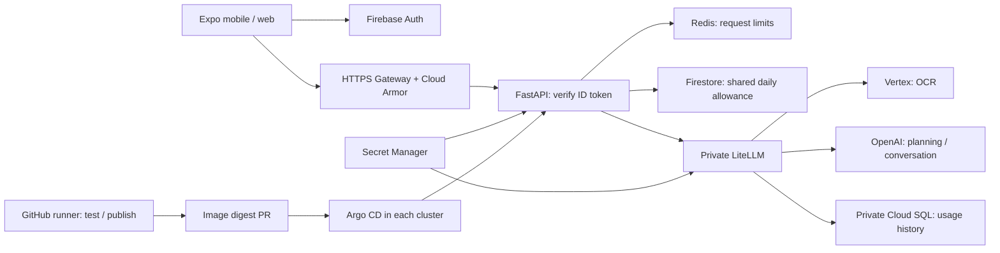

# GCP operations

Live project: `normies-main`. Both Argo applications are synced and healthy.

| Region | Cluster | API |
| --- | --- | --- |
| us-central1 | pocket-us | https://backend.normiesai.com |
| asia-southeast1 | pocket-sg | https://sg.backend.normiesai.com |

## Architecture



GKE has private nodes, NAT, Workload Identity and namespace network policies. Only the API Gateway is public. LiteLLM, Redis and Argo CD use private services. Existing Firebase auth settings and unrelated Firestore databases were preserved; quotas use the named `pocket-usage` database.

## LiteLLM dashboard

LiteLLM routes requests to Vertex or OpenAI, centralizes provider credentials and records model usage/cost estimates. An OpenAI key authenticates that provider; LiteLLM supplies the shared routing and accounting layer.

```bash
./scripts/litellm-ui.sh us
```

Open http://localhost:4000/ui. Username: `admin`. Find the password in **Secret Manager → pocket-litellm-ui-password → latest version** in `normies-main`. To retrieve it locally:

```bash
./scripts/gcloud.sh secrets versions access latest --secret=pocket-litellm-ui-password --project=normies-main
```

Keep the tunnel running. It reconnects after a pod restart and binds only to localhost. For Singapore, run `./scripts/litellm-ui.sh sg 4002` and open http://localhost:4002/ui. Both regions share the same usage database; prompt/response storage is disabled. Routing remains in Git.

The managed Postgres 16 instance `pocket-litellm` is private in US central, accessed through authenticated Cloud SQL proxy sidecars. Backups, point-in-time recovery and deletion protection are enabled. It is a single-zone MVP instance; a US database outage affects both dashboards/proxies.

## Operator access

Downloaded CLIs are in ignored `.tools/`. Use a kubectl version compatible with GKE; these wrappers prefer the workspace copy.

```bash
./scripts/gcloud.sh auth login
./scripts/gcloud.sh auth application-default login
./scripts/kubectl.sh us -n pocket get pods
./scripts/kubectl.sh sg -n argocd get applications
./scripts/kubectl.sh us -n argocd port-forward svc/argocd-server 8443:443
```

Control planes accept only the operator CIDRs in ignored `infra/terraform/terraform.tfvars`. Update/apply those when your public IP changes. Argo CD uses a pinned v3.6.1 manifest; its admin secret stays in Kubernetes. Configure operator SSO before adding more operators.

## Infrastructure changes

Terraform state is stored in the restricted, versioned bucket `gs://normies-main-pocket-tfstate`, prefix `platform`. State contains generated internal credentials. Never commit state, plans, local input files or credentials.

```bash
.tools/terraform -chdir=infra/terraform init -backend-config=bucket=normies-main-pocket-tfstate -backend-config=prefix=platform
.tools/terraform -chdir=infra/terraform plan -out=platform.tfplan
.tools/terraform -chdir=infra/terraform apply platform.tfplan
```

DNS is managed in the existing `main-backend` zone. Only the approved API A records were changed. Both managed certificates are active. Clusters, NAT, Gateways, Cloud SQL and providers incur charges.

For a new project, start from `infra/terraform/terraform.tfvars.example` and `infra/deployment.example.json`. Import existing resources before managing them. `initialize_firebase` defaults to false to preserve existing auth settings. Bootstrap controllers with `scripts/bootstrap-argocd.sh us PROJECT_ID install` and the Singapore equivalent; publish real API images before creating the Argo applications.

## CI/CD

Repository: https://github.com/smg6135/my_smart_budgeter

GitHub variables and the `production` environment are configured:

- `GCP_PROJECT_ID`
- `GCP_WORKLOAD_IDENTITY_PROVIDER`
- `GCP_CI_SERVICE_ACCOUNT`

Run **Publish API release** on `main`. The GitHub-hosted runner tests, builds and pushes immutable images to both registries, then opens a digest PR and explicitly dispatches CI on that branch. Merge after CI passes; Argo CD deploys both clusters. Roll back by reverting the release PR.

The workflow uses `GITHUB_TOKEN` with contents, pull-request and Actions write permissions; no separate PR token is needed. GCP federation is restricted to this repository's main branch. CI can publish images and has no Kubernetes deployment permission. Argo respects HPA replica counts.

## Secrets and AI routes

Secret Manager holds OpenAI, LiteLLM master, Redis, database, salt and dashboard credentials. Workload Identity mounts only the secrets each service needs. Customers never supply provider keys. Public Firebase/OAuth client IDs belong in frontend configuration; provider keys do not.

| Task | Alias | Provider |
| --- | --- | --- |
| Bulk OCR | ocr-bulk | Vertex Gemini 3.5 Flash-Lite |
| Single OCR | ocr-single | Vertex Gemini 3.8 Flash |
| Planning | planning | OpenAI GPT-6 Luna |
| Conversation | conversation | OpenAI GPT-6 Sol |

Edit `services/ai/config.yaml`, then regenerate and validate:

```bash
services/api/.venv/bin/python scripts/generate-gitops-base.py
services/api/.venv/bin/python scripts/render-gitops.py
PATH="$PWD/.tools:$PATH" services/api/.venv/bin/python scripts/validate-platform.py
```

The ignored `infra/deployment.json` pins numeric Secret Manager versions. Update those and render again for credential rotation; generated hashes restart affected workloads. Redis rotation briefly interrupts requests. No retries/fallbacks silently select a more expensive model. Bulk upload uses concurrent requests, not the discounted asynchronous Batch API.

LiteLLM is pinned to vendor-signed v1.108.2, digest `sha256:d8b4ac356743d647a13bb93f45b941fcd5f5354122cfd205948a1b192790389d`. [Vendor release](https://github.com/BerriAI/litellm/releases/tag/v1.108.2).

## Limits and data

Cloud Armor applies SQLi/XSS rules and a 300 requests/minute IP throttle. Redis limits each UID to 60 requests/minute and 30 AI requests/minute per region. Firestore caps combined regional AI usage at 300 weighted units/day: bulk 1, single 3, planning 5, conversation 10. Verified email is required for AI. Failed provider calls consume reserved units. These are request limits; provider billing alerts/caps are separate.

Redis is a private single replica; a restart resets its short window. Limit-store failures return 503. Daily counters are durable, use hashed UIDs, expire after seven days and deny Firebase client access.

Budgets stay on each device. Identity is global, quota counters use US Firestore `nam5`, shared Postgres is US central, Vertex uses its global endpoint and OpenAI processes requests under its account terms. Regional clusters do not guarantee data residency.

## Verification and mobile

Live checks passed in both regions: all four AI routes, auth, FX, global daily quota and disabled-account rejection. Public planning with web search enabled completed. Dashboard login works, usage rows are recorded, and stored prompt/response counts are zero. Terraform reports no changes; both TLS certificates are active and Cloud Armor policies attached.

Run the cloud smoke test with operator ADC. It creates/deletes only its own throwaway account and quota document. `--ai` makes small paid calls; `--research` also enables planning web search.

```bash
services/api/.venv/bin/python scripts/smoke-cloud.py --url https://backend.normiesai.com
services/api/.venv/bin/python scripts/smoke-cloud.py --url https://sg.backend.normiesai.com --ai
```

Frontend production configuration is prepared in ignored `apps/mobile/.env.production`. Set those public values in EAS production, including an empty auth emulator URL. Google consent/native callbacks, camera, Keychain and real PDF/batch uploads need device checks. See [TestFlight](TESTFLIGHT.md).
