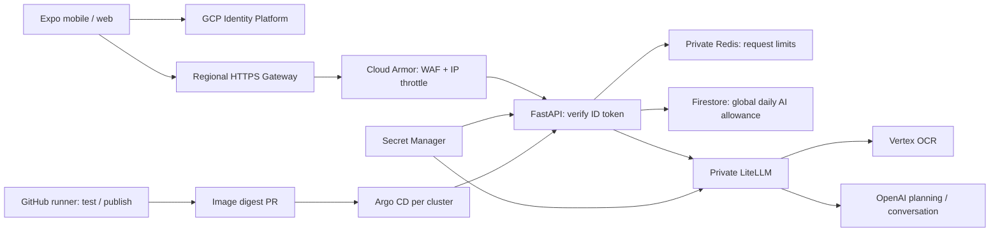

# GCP deployment

Code and manifests are prepared. Clusters are **not provisioned**: GCP project ID and authenticated operator access are still needed. The target project is `normies-main`; the approved domain is `backend.normiesai.com`.

## Architecture



| Region key | GKE location | Endpoint |
| --- | --- | --- |
| us | us-central1 | https://backend.normiesai.com |
| sg | asia-southeast1 | https://sg.backend.normiesai.com |

Two independent Autopilot clusters, private nodes, NAT and extensible namespace deployments. Argo CD UI, Redis and LiteLLM have no public service. Only the HTTPS Gateway exposes the API.

This deploys regional compute; it does not guarantee US/Singapore data residency. Identity is global, usage counters default to Firestore `nam5`, Vertex defaults to its global endpoint, and OpenAI processes requests under its own account terms. Budgets stay on devices. Counter records contain hashed UIDs and unit totals, expire after seven days, and cannot be read/written by Firebase clients.

## 1. Prerequisites

Install gcloud, Terraform 1.13+, kubectl and Python. This workspace also includes the downloaded CLI through `scripts/gcloud.sh`. Use a billing-enabled project with permission to enable APIs and manage GKE, networking, Firebase, IAM, DNS, Artifact Registry, Firestore and Secret Manager. Accept Firebase terms if prompted. Existing Firebase/Firestore resources must be imported into Terraform rather than recreated.

```bash
./scripts/gcloud.sh auth login
./scripts/gcloud.sh auth application-default login
./scripts/gcloud.sh config set project YOUR_PROJECT_ID
```

Create Google OAuth credentials in the same project:

- Web client: authorized origins for your web frontend; redirect URI `https://YOUR_PROJECT_ID.firebaseapp.com/__/auth/handler`.
- iOS client: bundle ID from `apps/mobile/app.json`.
- Android client if used: package ID plus development/release SHA fingerprints.
- Configure consent screen, test users, production publishing and Firebase authorized domains.

Google OAuth can be enabled after the clusters and email/password auth are created. Leave `google_oauth_client_id = ""` for the first apply. Before setting the client ID, seed its **web OAuth client secret**:

```bash
gcloud services enable secretmanager.googleapis.com
gcloud secrets create pocket-google-oauth-secret --replication-policy=automatic
gcloud secrets versions add pocket-google-oauth-secret --data-file=/secure/path/oauth-secret
```

Do not commit secret files. The OAuth secret and generated internal credentials enter Terraform state. Use a restricted, versioned GCS state bucket with public access prevention; never commit local state or plans.

## 2. Terraform

Create the state bucket once:

```bash
gcloud storage buckets create gs://YOUR_PROJECT_ID-pocket-tfstate --location=us-central1 --uniform-bucket-level-access --public-access-prevention
gcloud storage buckets update gs://YOUR_PROJECT_ID-pocket-tfstate --versioning
cp infra/terraform/terraform.tfvars.example infra/terraform/terraform.tfvars
```

Fill project, owned API subdomain, exact GitHub repo/owner numeric ID, OAuth client ID, web origins and your operator public IP CIDR. Control planes reject `0.0.0.0/0`. API nodes have separate service identities; CI can publish images and has no cluster admin role.

```bash
terraform -chdir=infra/terraform init -reconfigure -backend-config=bucket=YOUR_PROJECT_ID-pocket-tfstate -backend-config=prefix=platform
terraform -chdir=infra/terraform plan -out=platform.tfplan
terraform -chdir=infra/terraform apply platform.tfplan
terraform -chdir=infra/terraform output
```

The requested domain is `backend.normiesai.com`. Its current A record resolves to `136.68.87.233`; inspect the existing Cloud DNS zone before replacing it. Delegate the backend subdomain to the output nameservers, or set `dns_zone_name` and import/manage its records in the existing authoritative zone. Do not change unrelated DNS records. Terraform creates two gateway IPs, DNS records and Google-managed certificates. DNS delegation and certificate provisioning must complete before HTTPS works. Two clusters, NATs, gateways and AI usage incur charges.

Seed the operator OpenAI key:

```bash
gcloud secrets versions add pocket-openai-key --data-file=/secure/path/openai-key
```

Terraform creates the random LiteLLM/Redis credentials. Secret values are mounted as files; they are absent from manifests and frontend bundles. All apps use Workload Identity, not service-account JSON keys.

For stronger password requirements, configure Identity Platform's password policy. Verify email before paid AI calls. Google accounts with verified emails are accepted.

## 3. Render and publish

```bash
cp infra/deployment.example.json infra/deployment.json
```

Fill public project/domain/origins/repo and exact Secret Manager version numbers. Render:

```bash
services/api/.venv/bin/python scripts/render-gitops.py
services/api/.venv/bin/python scripts/validate-platform.py
```

The checked-in example contains a zero API digest and cannot bootstrap. Publish the first release to replace it.

GitHub repository variables:

| Variable | Value |
| --- | --- |
| GCP_PROJECT_ID | project ID |
| GCP_WORKLOAD_IDENTITY_PROVIDER | Terraform `ci_provider` |
| GCP_CI_SERVICE_ACCOUNT | Terraform `ci_service_account` |

Create a `production` GitHub environment and set `RELEASE_PR_TOKEN` to a narrowly scoped bot token with repository contents and pull-request write access. A GitHub App installation token can replace it. This token allows release PRs to trigger CI; the default `GITHUB_TOKEN` would suppress those events. Enable Actions PR creation and require CI checks on main.

Push this repository configuration to GitHub, then run **Publish API release** manually on main. The GitHub-hosted runner tests, builds Linux amd64 images, pushes to all two registries and opens a digest update PR. Merge it after CI passes. CI does not call kubectl against production.

## 4. Bootstrap Argo CD

From an allowed operator IP:

```bash
scripts/bootstrap-argocd.sh us YOUR_PROJECT_ID
scripts/bootstrap-argocd.sh sg YOUR_PROJECT_ID
```

Argo CD v3.6.1 is installed from a pinned source commit. For a private repo, configure a read-only deploy key in each Argo instance. Its UI is reachable only through a local port-forward:

```bash
kubectl -n argocd port-forward svc/argocd-server 8443:443
```

Use the initial admin secret locally, change the password, and configure operator SSO. Do not expose Argo CD through the customer Gateway. Each AppProject permits this repo, the local cluster and the Pocket namespace.

Merged configuration syncs automatically. Roll back by reverting the release PR. New services receive their own ServiceAccount, permissions, policies and manifests.

## 5. Configure frontend

Use `terraform output firebase_public_config` for public Firebase values. Set production EAS environment variables listed in `apps/mobile/.env.example`, including the two HTTPS region endpoints, OAuth client IDs and reversed iOS client URL scheme.

Remove `EXPO_PUBLIC_AUTH_EMULATOR_URL` from release environments; release builds reject it. Native Google sign-in requires a new development/store build. A release frontend sends tokens only to configured HTTPS origins.

## Limits and AI routes

Cloud Armor applies basic SQLi/XSS rules and 300 requests/minute per source IP. API Redis limits each customer to 60 requests/minute and 30 AI requests/minute per region. A Firestore transaction caps the **combined two-region** daily weighted allowance: bulk OCR 1, single OCR 3, planning 5, conversation 10; default 300 units/day. Failed provider calls still consume reserved units. Unit limits bound requests, not exact dollars; configure provider project spend caps/alerts too.

Redis is a private ephemeral single replica per cluster. A restart resets its short window; unavailability fails closed with 503. Firestore daily quotas remain durable. Scale/replace Redis with a managed HA service as traffic grows.

LiteLLM routes are in `services/ai/config.yaml`. After changing them, run `scripts/generate-gitops-base.py` with the API venv Python and commit generated manifests. Numeric secret-version changes roll the workloads through generated configuration hashes. Redis credential rotation restarts Redis and briefly interrupts requests. No retries/fallbacks silently upgrade to a more expensive model. Bulk upload means concurrent requests, not a provider's discounted asynchronous Batch API.

The proxy is pinned to signed v1.108.2, digest `sha256:d8b4ac356743d647a13bb93f45b941fcd5f5354122cfd205948a1b192790389d`. Its vendor cosign signature was verified. Avoid floating tags, including the previously compromised v1.107.0. [Vendor release](https://github.com/BerriAI/litellm/releases/tag/v1.108.2), [incident report](https://docs.litellm.ai/blog/security-incident-oct-21-2026).

Provider routes were checked against [Vertex model lifecycle](https://docs.cloud.google.com/gemini-enterprise-agent-platform/models/model-versions), [GPT-6 Luna](https://developers.openai.com/api/docs/models/gpt-6-luna) and [GPT-6 Sol](https://developers.openai.com/api/docs/models/gpt-6-sol). Live schema/image/PDF/search compatibility still requires account smoke tests. Do not promise OCR accuracy or cost savings until receipts are evaluated.

## Live acceptance

For each region:

1. Confirm Argo sync, API readiness, Gateway conditions, certificate status and Cloud Armor attachment.
2. `/health` returns 200; every `/v1/` endpoint returns 401 without a valid Firebase token.
3. Sign in on mobile; test signup, email verification, Google OAuth, refresh, revocation and account switching.
4. Scan a single receipt, a 20-file batch, and a PDF; verify chosen routes and review amounts before saving.
5. Test planning with/without web search and conversation mode.
6. Confirm 429 for quota exhaustion, 503 when Redis/Firestore is unavailable, and no provider key or financial payload in logs.
7. Verify external callers cannot reach Redis, LiteLLM, Argo UI or direct pod services.

Infrastructure validation does not replace these live checks. GCP provisioning, DNS, OAuth consent, native signing and provider credentials remain account-specific.

References: [GKE Gateway policies](https://docs.cloud.google.com/kubernetes-engine/docs/how-to/configure-gateway-resources), [Secret Manager add-on](https://docs.cloud.google.com/secret-manager/docs/secret-manager-managed-csi-component), [LiteLLM Responses API](https://docs.litellm.ai/docs/response_api), [Firebase Auth REST](https://firebase.google.com/docs/reference/rest/auth).

## LiteLLM dashboard

Both regions share a private Cloud SQL Postgres database for usage history. Prompt and response storage is disabled. Provider credentials remain in Secret Manager; model routing stays in Git.

Open a private cluster tunnel:

```bash
./scripts/litellm-ui.sh us
```

Visit http://localhost:4000/ui. Username: `admin`. Retrieve the dashboard password locally:

```bash
./scripts/gcloud.sh secrets versions access latest --secret=pocket-litellm-ui-password --project=normies-main
```

Use `./scripts/litellm-ui.sh sg 4002` for Singapore at http://localhost:4002/ui. The database is shared, so both show aggregated usage. Only the GCP-authenticated tunnel exposes the dashboard; customer Gateways expose API routes only.
